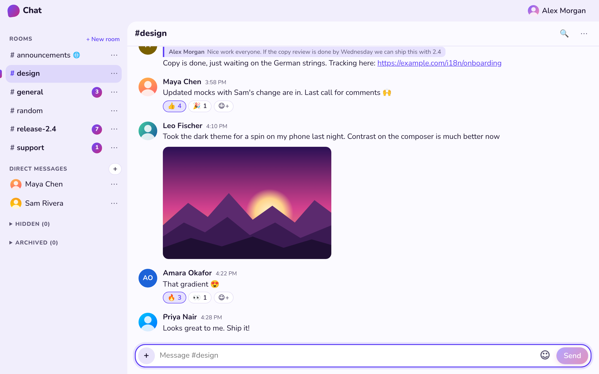

# Chat

A small, fast, real-time group chat. One [PocketBase](https://pocketbase.io) binary is the whole backend
(auth, data, realtime, static files); the frontend is vanilla TypeScript bundled by esbuild — no framework,
~47 KB of JS and ~7 KB of CSS gzipped (`npm run build` fails over its budget: 47.10 KB of JS, 7.10 KB of CSS).

<picture>
  <source media="(prefers-color-scheme: dark)" srcset="docs/screenshot-dark.png">
  
</picture>

- Public rooms anyone can create; hide rooms you don't care about; creators archive rooms (read-only, history kept)
- Room access, chosen by each room's creator: **Private** (only the people they add), **Public** (everyone with an account) or **Open Air** (anyone can read it, no account needed; the home page shows these rooms to guests, who log in or sign up to join in); and who can post: everyone who can read it, or only the people they choose (the others read and react)
- Live messages, edits and deletes (deleted messages leave a placeholder)
- Full history: scroll back to the very first message of any room (windowed, ≤300 messages in the DOM)
- Direct messages between any two users, private to them; close a conversation and it comes back on the next message
- Avatars (or colored initials) and a profile page to change your picture, display name (unique) and password, and to log out
- Search in any room or DM: every word you type, in any case ("привет" finds "Привет"), newest first; pick a result to go to it, however far back
- Replies: answer any message with a quote of it; click the quote to jump to the original, however far back
- Links in messages are clickable and open in a new tab (http, https and www. addresses only)
- Emoji: a picker in the composer, and reactions on any message (as many different ones as you like), live for everyone
- Attachments: up to 10 files of 20 MB per message, with an upload progress bar; images shown as thumbnails and videos as their first frame (4 tiles, then "+N"); files are private to whoever can read the message
- Image viewer: click a thumbnail to see it full size (or a video to play it) and step through the room's images and videos (buttons, arrow keys, swipe);
  loaded only when first used, so it adds nothing to the page's first load
- Collections: save any image or video from the chat to collections of your own, public or private, and attach from them to messages; subscribe to other people's public collections to use theirs too, with a count of what's new and the new items highlighted; media attached from a collection link to it (or say "Private collection")
- Select messages (up to 50): forward them to any room or DM, with "Forwarded from" and their attachments (forwards show the original, so nothing is copied), or delete them together when they are yours
- Unread counts on every room and DM, live, and in sync across your tabs and devices; the total shows in the tab's favicon and title;
  a room with unread messages opens at the first of them, under a "New" line
- What you were typing is kept per room, even across a reload; "Jump to latest" whenever you are scrolled up
- Your own branding (title and logo) and, if you like, invite-only signups: set by the admin in PocketBase
- Telegram bridge (optional): link rooms to Telegram groups through a bot; messages, replies, edits and files go both ways (deletes from the chat to Telegram), Telegram people show under stand-in accounts with their names and pictures — see [Telegram integration](#telegram-integration)
- Fast room switching: each room's latest messages are kept in the browser (IndexedDB) and shown at once while the
  server answers; unread rooms are fetched ahead. Attachment thumbnails are kept by the service worker, so going back
  to a room (or reloading) doesn't download them again. All of it is cleared on logout
- Installable as an app (PWA: Add to Home Screen, the browser's Install button); it opens offline to its shell
- Optimistic sending with safe retries, reconnect gap-fill, light/dark themes, works on phones
- A native Android app (Kotlin, Jetpack Compose) with the same features, push notifications and a 3 MB download — see
  [Android app](#android-app)

Design: [`docs/DESIGN.md`](docs/DESIGN.md) · Android app: [`docs/ANDROID.md`](docs/ANDROID.md) · QA: [`docs/QA.md`](docs/QA.md) · Refactoring plan: [`docs/REFACTOR.md`](docs/REFACTOR.md) · Archived plans: [MVP build](docs/history/BUILD_PLAN.md), [avatars, DMs, attachments](docs/history/NEXT_FEATURES_PLAN.md)

## Requirements

- Node.js ≥ 22 and npm ≥ 11
- Linux or macOS (x64/arm64) — `npm run setup` downloads the matching PocketBase binary
- For e2e tests: Playwright's Chromium (`npx playwright install chromium`)

## Getting started

```sh
npm ci
npm run setup      # downloads the pinned PocketBase (checksum-verified) into bin/
npm run dev        # esbuild watch + PocketBase on http://127.0.0.1:8090
```

Open http://127.0.0.1:8090 and sign up (top right). The dev database lives in `pb_data/` — delete it to start over.
The PocketBase admin UI is at http://127.0.0.1:8090/_/ (create a superuser with
`bin/pocketbase superuser upsert you@example.com <password> --dir=pb_data`).

## Scripts

| Script | What it does |
|---|---|
| `npm run dev` | Unminified watch build into `pb_public/` + `pocketbase serve --dev` |
| `npm run build` | Production build (hashed assets) into `pb_public/`; fails if over the size budget |
| `npm run typecheck` | `tsc` (strict) for the frontend, tests and scripts, plus `pb_hooks/` + `pb_migrations/` against PocketBase's generated types (`types/pocketbase.d.ts`, written by `scripts/pb-types.sh`) |
| `npm run lint` | Biome: formatting, lint rules, import order (`npm run format` applies the fixes) |
| `npm run lint:sinks` | Fails if frontend code uses `innerHTML` & co. (XSS guard) |
| `npm test` | Unit/view tests (Vitest + happy-dom) against a real, throwaway PocketBase |
| `npm run test:int` | Integration tests: schema, API rules, hooks, realtime, pagination |
| `npm run test:e2e` | Playwright end-to-end tests against the production build |
| `npm run schema:snapshot` | Rewrite `docs/schema.snapshot.json` (every collection's API rules, fields and indexes, and the rate limits) after a migration changes them; `test:int` fails while it is out of date |
| `npm run screenshots` | Rewrite the README screenshots (`docs/screenshot-*.png`): a throwaway server with made-up people and messages, photographed in Chromium after `npm run build` |
| `npm run check` | typecheck + lint + lint:sinks + test + test:int + build (what CI runs before e2e) |

Every test run starts its own PocketBase on a free port with a temp data dir — nothing to clean up, and no fakes
except a stub Telegram Bot API for the bridge's tests. CI (`.github/workflows/ci.yml`) runs typecheck, lint and build, then unit, integration and e2e side by side, e2e once
per browser (Chromium, Firefox, WebKit).

## Project layout

```
pb_migrations/   schema + API rules (the source of truth for access control)
pb_hooks/        server-side hooks: trimming, soft delete, edit/archive stamps, DM + unread routes, guards, security headers;
                 telegram.pb.js + telegram/: the optional Telegram bridge
web/src/         frontend: api.ts (the only module that talks to PocketBase, through pb.ts, a minimal client), router,
                 store, cache.ts (the room cache), sw.ts (the service worker), views/, lib/ (pure logic)
web/styles/      app.css (bundles app/*.css, one file per part) and viewer.css
scripts/         build, dev, fetch-pocketbase, pb-types (PocketBase's types for the hooks), html-sink check
tests/           unit/, integration/, e2e/, perf/ (scale measurements), support/ (PocketBase harness, Telegram stub, helpers)
android/         the Android app (docs/ANDROID.md): core/data (API, realtime, database, sync), core/ui, feature/*, app
```

## Deploying

Build once, then copy `bin/pocketbase`, `pb_public/`, `pb_migrations/` and `pb_hooks/` to the server.
Migrations run automatically on start.

```sh
npm ci && npm run setup && npm run build
rsync -a bin/pocketbase pb_public pb_migrations pb_hooks server:/opt/chat/
```

With a domain pointing at the server, PocketBase serves HTTPS itself (Let's Encrypt):

```ini
# /etc/systemd/system/chat.service
[Unit]
Description=Chat (PocketBase)
After=network-online.target

[Service]
User=chat
WorkingDirectory=/opt/chat
ExecStart=/opt/chat/pocketbase serve chat.example.com --hooksPool=100 --dir=/opt/chat/pb_data --publicDir=/opt/chat/pb_public --migrationsDir=/opt/chat/pb_migrations --hooksDir=/opt/chat/pb_hooks
Restart=on-failure
AmbientCapabilities=CAP_NET_BIND_SERVICE
LimitNOFILE=65536

[Install]
WantedBy=multi-user.target
```

```sh
sudo systemctl enable --now chat
sudo -u chat /opt/chat/pocketbase superuser upsert you@example.com <password> --dir=/opt/chat/pb_data
```

Behind an existing reverse proxy instead, use `serve --http=127.0.0.1:8090` and proxy to it (keep
`/api/realtime` unbuffered — it is a Server-Sent Events stream — and let request bodies through up to 210 MB, since a
message may carry 10 files of 20 MB), and start PocketBase with
`TRUSTED_PROXY=X-Forwarded-For` (`Environment=` in the unit). The rate limits are per client IP: without it, every
request seems to come from the proxy, and one client tripping a limit trips it for everyone. The rightmost address of
the header is used, the one your proxy added. The Docker image sets it (Dokku always runs a proxy in front); run it
with `-e TRUSTED_PROXY=off` if clients reach port 8090 directly, since they could then choose their own IP. Unset, the
setting is left as configured under *Settings → Application* in the admin UI.

### Dokku

The `Dockerfile` builds the production image (frontend + pinned PocketBase), and `app.json` gives Dokku its health
check. On the server:

```sh
dokku apps:create chat
# All data (SQLite + uploads) lives in /pb_data: keep it on the host. The directory is owned by uid 32767, the
# image's user.
dokku storage:ensure-directory chat
dokku storage:mount chat /var/lib/dokku/data/storage/chat:/pb_data
dokku domains:set chat chat.example.com
# nginx allows 1 MB bodies by default; a message may carry 10 files of 20 MB.
dokku nginx:set chat client-max-body-size 210m
dokku letsencrypt:enable chat   # with the dokku-letsencrypt plugin
```

Then deploy (`git push dokku master` from a clone with `dokku@server:chat` as the `dokku` remote) and create a
superuser:

```sh
dokku run chat /app/pocketbase superuser upsert you@example.com <password> --dir=/pb_data
```

Settings go in as environment variables (`dokku config:set chat KEY=value`, which restarts the app); the image already
sets `TRUSTED_PROXY` for Dokku's proxy. `dokku logs chat -t` shows PocketBase's output; the app's own log (request
log and errors from hooks) is in the admin UI under *Logs*.

### Running it

**Branding and invite-only signups:** in the admin UI, *Collections → site*, edit the one record: `title` and `logo`
are shown in the app bar, on the login page and in the tab's title. Tick `invite_only` and fill `invite_code` to let
only people who have the code sign up (they enter it on the Sign up form; it is case-sensitive). Change the code to stop
the old one working; leave it empty to close signups. Existing accounts are unaffected, and you can still create
accounts yourself under *Collections → users*.

**Backups:** in the admin UI, *Settings → Backups* — schedule automatic backups (optionally to S3-compatible
storage). Uploaded files (avatars, attachments) live in `pb_data/storage` (or S3, under *Settings → Files storage*) and
are part of the backups, so plan disk space for them. **Rate limits** (per IP: messages 10 per 5 s, edits/deletes 20
per 10 s, reactions 30 per 10 s, forwarding and deleting several messages 20 requests per minute each, password changes 5 per minute, new rooms 5 per minute, opening DMs 10 per minute, marking rooms read 120 per minute, signups 20 per minute; PocketBase defaults for the rest)
are set by the migrations and adjustable under *Settings → Rate limits*.

## Android app

**Frozen since 2026-10-21:** only the web client is being worked on. The app is not changed, built or tested until it
is unfrozen ([`CLAUDE.md`](CLAUDE.md)).

A native client for any server running the chat, with several accounts at once on one server or many (`android/`,
design: [`docs/ANDROID.md`](docs/ANDROID.md), §17 for servers and accounts). It needs JDK 17+
(21 recommended) and the Android SDK (`ANDROID_HOME`, or `sdk.dir` in `android/local.properties`); Gradle fetches the
rest. Its tests start PocketBase from `bin/`, so run `npm run setup` first.

```sh
cd android
./gradlew assembleDebug          # app/build/outputs/apk/debug: offers http://10.0.2.2:8090 (the dev server, from the emulator)
./gradlew check                  # lint, unit tests, API tests against PocketBase, UI tests on Robolectric
./gradlew checkApkSize -Pchat.server=https://chat.example.org -Pchat.appId=org.example.chat
```

People choose their server when they log in or sign up (Change server), and add more accounts from their profile.
A build only sets the server offered first: `-Pchat.devServer=http://192.168.1.20:8090` for a debug build on a device,
`chat.server` for a release (without one, the app asks for a server, and no host's links open in the app). Debug builds
take http addresses; release builds take https only. `chat.fcm.projectId`, `chat.fcm.appId`, `chat.fcm.apiKey` and `chat.fcm.senderId`
turn on Firebase push. On the server, push needs `FCM_SERVICE_ACCOUNT` (the service account's JSON, of the app's Firebase
project: servers without it get no pushes, ANDROID.md §17.4), and links to rooms on the build's server open in the app with `ANDROID_APP_ID` and `ANDROID_CERT_SHA256` (`/.well-known/assetlinks.json`). An admin can set
`min_android_version` on the site record to make older apps ask for an update. What is built and what isn't yet:
[`docs/ANDROID.md` §16](docs/ANDROID.md#16-implementation-2026-10-18), and [`android/PARITY.md`](android/PARITY.md).

## Link previews

Messages show a line under them for each link: the page's favicon and title ([`docs/DESIGN.md` §28](docs/DESIGN.md)).
The server fetches them with `curl` (in the Docker image), only from public addresses. Set `LINK_PREVIEWS=off` to turn
it off.

## Media grid

Each room's Media button shows its images and videos as a grid ([`docs/DESIGN.md` §30](docs/DESIGN.md)). A worker on
the server makes their thumbnails ahead of time, and a poster frame for each video with `ffmpeg` (in the Docker
image), which the room shows too, so browsers don't load videos just to draw their first frame. Set `FFMPEG=off` to
go without: videos then show their first frame in the room as before, and plain tiles in the grid.

## Telegram integration

An optional bridge between rooms and Telegram groups ([`docs/DESIGN.md` §26](docs/DESIGN.md)). A bot sits in your
groups; once a group is linked to a room, messages, replies, edits and files go both ways (deletes only from the chat
to Telegram). Telegram people show in the room under stand-in users ("Ann Lee (TG)") with their names and pictures;
the bot posts chat messages with the author's name above them.

**Setup**

1. Create a bot with [@BotFather](https://t.me/BotFather) (`/newbot`) and keep its token. Turn its privacy mode off
   (`/setprivacy` → Disable) so it sees group messages; if the bot is already in a group, remove it and add it again.
2. Set the environment and restart:
   - `TELEGRAM_BOT_TOKEN` — the bot's token (without it the bridge is off)
   - `TELEGRAM_WEBHOOK_URL` — `https://<your domain>/api/telegram/webhook` (without it the bridge polls Telegram,
     for local development)

   With Dokku: `dokku config:set chat TELEGRAM_BOT_TOKEN='…' TELEGRAM_WEBHOOK_URL='https://chat.example.com/api/telegram/webhook'`.
3. Add the bot to a Telegram group. A row for it appears in the admin UI under *Collections → tg_links*: pick the
   room and tick `enabled`. `/chatid` in the group says whether it is linked.

The bridge is self-contained: `pb_hooks/telegram.pb.js`, `pb_hooks/telegram/` and its own `tg_*` collections. Delete
the first two to remove it.

## License

[GNU General Public License v3.0](LICENSE) or later.
